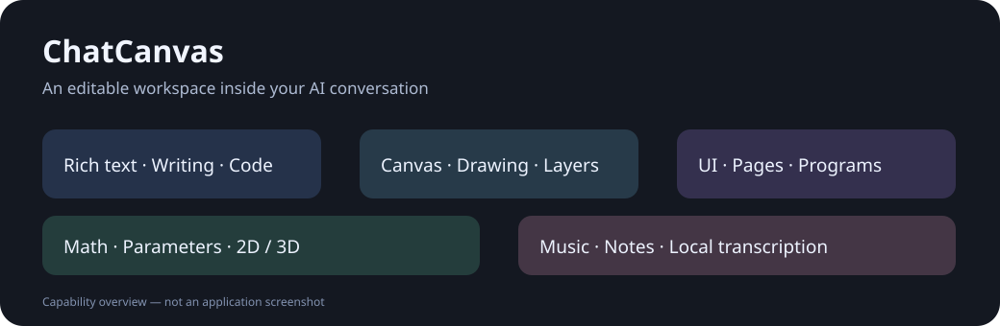

# 对话画布 · ChatCanvas

[English](README.md) | [简体中文](README.zh-CN.md)

[下载测试版](https://github.com/Tryanstm/dsh-chatcanvas/releases) · [安装说明](docs/INSTALL.zh-CN.md) · [反馈问题](https://github.com/Tryanstm/dsh-chatcanvas/issues)

**把 AI 对话变成可以编辑、探索和试听的工作空间。**

ChatCanvas 是 [DeepSeek Harness](https://github.com/deepseek-ai/deepseek-harness) 的第三方插件。在对话中使用富文本、画布、交互界面、数学图像和音乐编辑器，边讨论边修改。

## 看看实际操作

三段由真实录屏剪辑的短演示，可直接在下方播放，也可下载 MP4。等待与打字过程已加速，片段在后续 AI 回复出现前结束。视频配有中英文功能说明，软件界面为简体中文。

### 表达更清楚 · 21 秒

使用标题、引用和颜色，整理数学表达，再补充改动说明。开头的格式示例为静态截图，视频中已注明。

https://github.com/user-attachments/assets/b8679eac-9fc5-479a-9335-aa826f832c0c

[下载 MP4](https://github.com/Tryanstm/dsh-chatcanvas/raw/refs/heads/main/media/demos/compose.mp4)

### 把想法画出来 · 26.5 秒

在输入框中插入画布，直接勾画界面布局，补上图像区、控件和注记。

https://github.com/user-attachments/assets/82bdbab1-b996-42c0-a54e-44af016d4413

[下载 MP4](https://github.com/Tryanstm/dsh-chatcanvas/raw/refs/heads/main/media/demos/canvas.mp4)

### 边讨论，边修改 · 24 秒

在界面草案中选中并拖动控件，调整结果面板和文字的位置。

https://github.com/user-attachments/assets/5737babc-d01e-439c-95f1-6cfb779e6cde

[下载 MP4](https://github.com/Tryanstm/dsh-chatcanvas/raw/refs/heads/main/media/demos/ui-editor.mp4)

[录屏说明与后续演示的补充方式](docs/DEMOS.md#简体中文)

## 功能

| 功能 | 可以做什么 |
| --- | --- |
| 富文本输入与消息 | 写作框、纯文本框、代码高亮、复制和原生文件引用 |
| 画布 | 手绘、实时擦除、吸附对齐、层级调整、复制并编辑作品 |
| 交互 UI | 制作多个页面、编辑图形程序，并直接试用界面 |
| 数学图像 | 探索函数、方程、参数和二维／三维图像 |
| 音乐 | 编辑音符与音轨、试听乐器、导入 MIDI、导出 MIDI/WAV，以及本地 WAV/MP3 转录 |
| 可编辑提问 | AI 展示草案，你直接调整，再把结果提交给 AI |

功能概览图

## 安装

当前是**公开测试版**。已验证的集成目标为 Harness **0.2.0-rc.2 和 0.2.1-rc.2**。安装辅助脚本适用于 Windows；其他系统及宿主版本尚未验证。

1. 在 [Releases 发布页](https://github.com/Tryanstm/dsh-chatcanvas/releases)下载 `local-dsh-chatcanvas-1.4.0-rc.12.tgz`。
2. 完全退出 Harness。
3. 通过桌面应用自带 CLI，或宿主支持的本地插件包入口安装。
4. 重新打开，在设置中找到 **对话画布 · ChatCanvas**。

GitHub 自动生成的 **Source code** 是开发源码，不能直接作为插件包安装。详细步骤、更新与回退见[安装说明](docs/INSTALL.zh-CN.md)。

## 怎么开始

正常输入消息，或在输入框中右键插入内容。可以让 AI 制作 UI、数学图像、音乐作品或组合画布。已经发送的作品需要复制为可编辑副本后再修改。

可以这样说：

- “制作一个两页计时器界面，让我直接试用。”
- “画出 y = a*x²，让我调节 a。”
- “制作一段短钢琴旋律，把音符显示出来让我修改。”
- “先给我一份可以直接调整的布局草案，再询问我的意见。”

本版界面语言为**简体中文**；提供中英文文档，尚未包含完整英文界面。

## 设置

打开 **设置 → 对话画布 · ChatCanvas**。公开插件只提供两项设置：

| 选项 | 默认数量 | 调整方式 |
| --- | --- | --- |
| 程序推荐选项 | 2 项 | 点击数字，在弹窗中选择 0–5 项，再保存 |
| AI 推荐选项 | 1 项 | 点击数字，在弹窗中选择 0–5 项，再保存 |

执行审核、审核开关和工具／Skill 白名单不在本插件中。宿主自带的权限菜单继续保留。为兼容旧作品，内部文档格式和存储标识保持不变。

## 权限、隐私与费用

插件不注册执行前审核，也不更改宿主权限预设。宿主权限继续生效。画布、UI 编辑和音频转录使用本地代码及随包资源；AI 推荐、翻译、推荐质量检查和自动生成会话标题会使用 Harness 配置的模型，可能产生额外用量。详见[隐私说明](docs/PRIVACY.zh-CN.md)。

## 测试版限制

- 音频转录给出可修改的识别结果；复杂混音、多人声及重叠乐器可能识别不准。
- 采样播放不等同于专业乐器音源，部分乐器的真实感仍有限。
- UI 模拟验证逻辑，不能代替视觉验收。
- 长时间绘制、高 DPI 及与其他插件组合的正式窗口体验仍需更多测试。
- 普通 Markdown 表格继续支持，旧版独立增强表格编辑器已经退役。

## 开发与反馈

[构建与测试](docs/DEVELOPMENT.md) · [集成说明](docs/INTEGRATION.md) · [结构协议](docs/PROTOCOL.md)

反馈问题时请提供插件版本、Harness 版本、系统和复现步骤；截图及示例先去掉密钥、私人聊天和个人文件。

## 许可与来源

插件代码采用 [MIT](LICENSE)。第三方素材分别保留原许可：TimGM6mb 音源为 **GPL-2.0-only**；Basic Pitch 与 TensorFlow.js 资源为 **Apache-2.0**。详见[第三方声明](THIRD_PARTY_NOTICES.md)及随包许可、素材源文件。代码的 MIT 标识不改变第三方资源的许可。

这是非官方第三方项目，与 DeepSeek 没有隶属或背书关系。沿用的宿主组件保留原始版权声明。
